# Project Knowledge Graph Report

Generated automatically by Graphify.

---

## 1. Architectural Metrics

* Total Scanned Files: 46
* Total Module Relationships: 25

### File Breakdown by Extension
* **.example**: 1 files
* **.gitkeep**: 1 files
* **[no-ext]**: 1 files
* **.ts**: 9 files
* **.json**: 8 files
* **.js**: 2 files
* **.md**: 11 files
* **.yml**: 1 files
* **.css**: 1 files
* **.gitignore**: 1 files
* **.html**: 1 files
* **.tsx**: 9 files

---

## 2. Core Hub Nodes (Entry Points & Anchors)

* docker-compose.yml
* package.json
* README.md
* client/index.html
* client/package.json
* client/src/App.tsx
* client/src/index.css
* client/src/main.tsx
* server/package-lock.json
* server/package.json
* server/tsconfig.json
* server/src/index.ts
* server/src/types.ts
* server/src/parsers/markdown.ts
* server/src/services/photos.ts
* server/src/services/timers.ts
* server/src/services/vault.ts
* server/src/services/weather.ts

---

## 3. Structural Map Diagram

```mermaid
flowchart TD
    client_src_App_tsx["client/src/App.tsx"] --> __components_AmbientBackground["./components/AmbientBackground"]
    client_src_App_tsx["client/src/App.tsx"] --> __components_Header["./components/Header"]
    client_src_App_tsx["client/src/App.tsx"] --> __components_KanbanWidget["./components/KanbanWidget"]
    client_src_App_tsx["client/src/App.tsx"] --> __components_TasksWidget["./components/TasksWidget"]
    client_src_App_tsx["client/src/App.tsx"] --> __components_CalendarWidget["./components/CalendarWidget"]
    client_src_App_tsx["client/src/App.tsx"] --> __components_TimersWidget["./components/TimersWidget"]
    client_src_App_tsx["client/src/App.tsx"] --> __components_NotesWidget["./components/NotesWidget"]
    client_src_App_tsx["client/src/App.tsx"] --> __types["./types"]
    client_src_main_tsx["client/src/main.tsx"] --> __App["./App"]
    client_src_components_CalendarWidget_tsx["client/src/components/CalendarWidget.tsx"] --> ___types["../types"]
    client_src_components_Header_tsx["client/src/components/Header.tsx"] --> ___types["../types"]
    client_src_components_KanbanWidget_tsx["client/src/components/KanbanWidget.tsx"] --> ___types["../types"]
    client_src_components_NotesWidget_tsx["client/src/components/NotesWidget.tsx"] --> ___types["../types"]
    client_src_components_TasksWidget_tsx["client/src/components/TasksWidget.tsx"] --> ___types["../types"]
    client_src_components_TimersWidget_tsx["client/src/components/TimersWidget.tsx"] --> ___types["../types"]
    server_src_index_ts["server/src/index.ts"] --> __services_vault_js["./services/vault.js"]
    server_src_index_ts["server/src/index.ts"] --> __services_timers_js["./services/timers.js"]
    server_src_index_ts["server/src/index.ts"] --> __services_weather_js["./services/weather.js"]
    server_src_index_ts["server/src/index.ts"] --> __services_photos_js["./services/photos.js"]
    server_src_index_ts["server/src/index.ts"] --> __types_js["./types.js"]
    server_src_parsers_markdown_ts["server/src/parsers/markdown.ts"] --> ___types_js["../types.js"]
    server_src_services_timers_ts["server/src/services/timers.ts"] --> ___types_js["../types.js"]
    server_src_services_vault_ts["server/src/services/vault.ts"] --> ___parsers_markdown_js["../parsers/markdown.js"]
    server_src_services_vault_ts["server/src/services/vault.ts"] --> ___types_js["../types.js"]
    server_src_services_weather_ts["server/src/services/weather.ts"] --> ___types_js["../types.js"]
```

---

## 4. Agent Navigation Directives

1. Top-Down Inspection: Consult the Core Hub Nodes listed above before opening deep child files.
2. Context Economy: Use this graph to identify dependencies instead of performing broad directory-wide text searches.
3. Graph Refresh: Run generate_graph.ps1 after significant refactoring to update relationships.
