# Project Knowledge Graph Report

Generated automatically by Graphify.

---

## 1. Architectural Metrics

* Total Scanned Files: 150
* Total Module Relationships: 110

### File Breakdown by Extension
* **.example**: 2 files
* **.gitkeep**: 1 files
* **[no-ext]**: 1 files
* **.ts**: 22 files
* **.zip**: 2 files
* **.xml**: 1 files
* **.js**: 6 files
* **.md**: 48 files
* **.json**: 10 files
* **.yml**: 2 files
* **.css**: 6 files
* **.webp**: 2 files
* **.gitignore**: 1 files
* **.woff2**: 4 files
* **.html**: 2 files
* **.tsx**: 31 files
* **.svg**: 9 files

---

## 2. Core Hub Nodes (Entry Points & Anchors)

* docker-compose.yml
* package.json
* README.md
* client/index.html
* client/package.json
* client/src/App.tsx
* client/src/index.css
* client/src/main.tsx
* EMAI FREE Starter Vault/Machine/Outputs/README.md
* EMAI FREE Starter Vault/Machine/Workflows/Client Update/README.md
* EMAI FREE Starter Vault/Machine/Workflows/Client Update/output/README.md
* hq.easymachineai.com-1793757763290/index.html
* server/package-lock.json
* server/package.json
* server/tsconfig.json
* server/src/index.ts
* server/src/types.ts
* server/src/parsers/markdown.ts
* server/src/services/photos.ts
* server/src/services/timers.ts
* server/src/services/vault.ts
* server/src/services/weather.ts
* server/src/services/writer.ts
* tbh-dashboard-interactivo/docker-compose.yml
* tbh-dashboard-interactivo/client/src/App.tsx
* tbh-dashboard-interactivo/client/src/index.css
* tbh-dashboard-interactivo/server/src/index.ts
* tbh-dashboard-interactivo/server/src/types.ts
* tbh-dashboard-interactivo/server/src/parsers/markdown.ts
* tbh-dashboard-interactivo/server/src/services/vault.ts
* tbh-dashboard-interactivo/server/src/services/writer.ts
* vault/Machine/Outputs/README.md
* vault/Machine/Workflows/Client Update/README.md
* vault/Machine/Workflows/Client Update/output/README.md

---

## 3. Structural Map Diagram

```mermaid
flowchart TD
    client_src_App_tsx["client/src/App.tsx"] --> __components_AmbientBackground["./components/AmbientBackground"]
    client_src_App_tsx["client/src/App.tsx"] --> __components_Header["./components/Header"]
    client_src_App_tsx["client/src/App.tsx"] --> __components_DateStrip["./components/DateStrip"]
    client_src_App_tsx["client/src/App.tsx"] --> __components_StageHeroCarousel["./components/StageHeroCarousel"]
    client_src_App_tsx["client/src/App.tsx"] --> __components_FloatingDock["./components/FloatingDock"]
    client_src_App_tsx["client/src/App.tsx"] --> __components_WorkflowsView["./components/WorkflowsView"]
    client_src_App_tsx["client/src/App.tsx"] --> __components_KanbanWidget["./components/KanbanWidget"]
    client_src_App_tsx["client/src/App.tsx"] --> __components_TasksWidget["./components/TasksWidget"]
    client_src_App_tsx["client/src/App.tsx"] --> __components_CalendarWidget["./components/CalendarWidget"]
    client_src_App_tsx["client/src/App.tsx"] --> __components_TimersWidget["./components/TimersWidget"]
    client_src_App_tsx["client/src/App.tsx"] --> __components_NotesWidget["./components/NotesWidget"]
    client_src_App_tsx["client/src/App.tsx"] --> __components_FocusPanel["./components/FocusPanel"]
    client_src_App_tsx["client/src/App.tsx"] --> __components_QuickAdd["./components/QuickAdd"]
    client_src_App_tsx["client/src/App.tsx"] --> __components_TimerAlert["./components/TimerAlert"]
    client_src_App_tsx["client/src/App.tsx"] --> __components_Toast["./components/Toast"]
    client_src_App_tsx["client/src/App.tsx"] --> __lib_actions["./lib/actions"]
    client_src_App_tsx["client/src/App.tsx"] --> __types["./types"]
    client_src_main_tsx["client/src/main.tsx"] --> __App["./App"]
    client_src_components_CalendarWidget_tsx["client/src/components/CalendarWidget.tsx"] --> ___types["../types"]
    client_src_components_CalendarWidget_tsx["client/src/components/CalendarWidget.tsx"] --> ___lib_actions["../lib/actions"]
    client_src_components_CalendarWidget_tsx["client/src/components/CalendarWidget.tsx"] --> ___lib_useToday["../lib/useToday"]
    client_src_components_CalendarWidget_tsx["client/src/components/CalendarWidget.tsx"] --> ___lib_dates["../lib/dates"]
    client_src_components_DateStrip_tsx["client/src/components/DateStrip.tsx"] --> ___types["../types"]
    client_src_components_DateStrip_tsx["client/src/components/DateStrip.tsx"] --> ___lib_useToday["../lib/useToday"]
    client_src_components_FocusPanel_tsx["client/src/components/FocusPanel.tsx"] --> ___types["../types"]
    client_src_components_FocusPanel_tsx["client/src/components/FocusPanel.tsx"] --> ___lib_actions["../lib/actions"]
    client_src_components_FocusPanel_tsx["client/src/components/FocusPanel.tsx"] --> ___lib_useToday["../lib/useToday"]
    client_src_components_FocusPanel_tsx["client/src/components/FocusPanel.tsx"] --> ___lib_dates["../lib/dates"]
    client_src_components_FocusPanel_tsx["client/src/components/FocusPanel.tsx"] --> __TaskRow["./TaskRow"]
    client_src_components_GamificationWidget_tsx["client/src/components/GamificationWidget.tsx"] --> ___types["../types"]
```

---

## 4. Agent Navigation Directives

1. Top-Down Inspection: Consult the Core Hub Nodes listed above before opening deep child files.
2. Context Economy: Use this graph to identify dependencies instead of performing broad directory-wide text searches.
3. Graph Refresh: Run generate_graph.ps1 after significant refactoring to update relationships.
