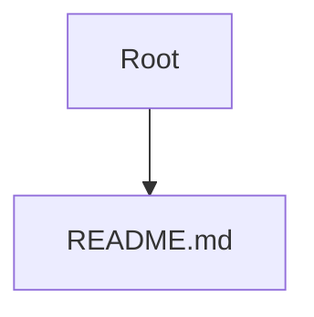

# Project Knowledge Graph Report

Generated automatically by Graphify.

---

## 1. Architectural Metrics

* Total Scanned Files: 10
* Total Module Relationships: 0

### File Breakdown by Extension
* **.example**: 1 files
* **.gitignore**: 1 files
* **.json**: 1 files
* **.md**: 7 files

---

## 2. Core Hub Nodes (Entry Points & Anchors)

* README.md

---

## 3. Structural Map Diagram

---

## 4. Agent Navigation Directives

1. Top-Down Inspection: Consult the Core Hub Nodes listed above before opening deep child files.
2. Context Economy: Use this graph to identify dependencies instead of performing broad directory-wide text searches.
3. Graph Refresh: Run generate_graph.ps1 after significant refactoring to update relationships.
